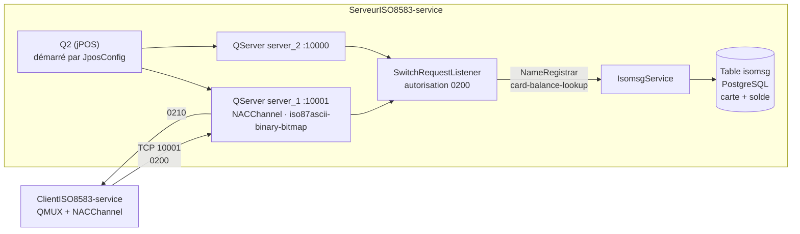
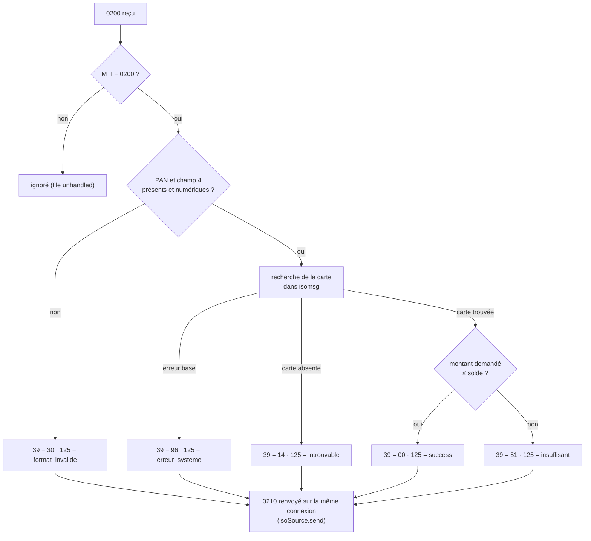
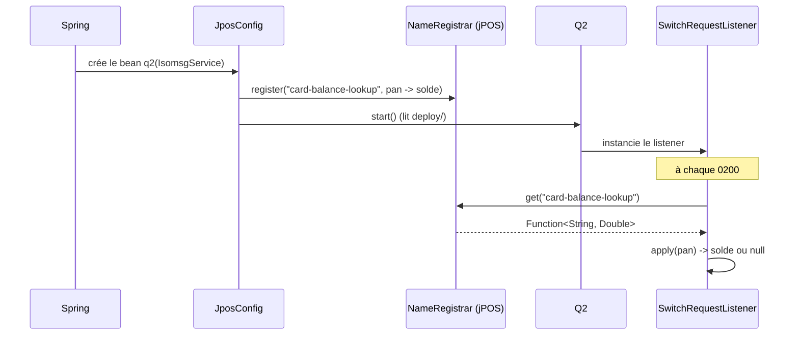

# ServeurISO8583-service

Service **switch / émetteur** du simulateur ISO 8583. Il écoute en TCP (jPOS `QServer`), reçoit
les demandes **0200**, vérifie la carte et le solde en base, puis répond **0210** avec le code
réponse (champ 39) et l'état de la transaction (champ 125).

- Spring Boot 2.7 · Java 17 · jPOS 2.1.7 · PostgreSQL (JPA)
- Port HTTP : **8081** (actuator)
- Ports ISO : **10001** (`server_1`) et **10000** (`server_2`)

## Architecture



## Logique d'autorisation



Le champ 4 est en **centimes** (`000000010000` = 100,00) ; le solde (`isomsg.amount`) est en unités.

## Codes réponse (champ 39)

| Code | Champ 125 | Signification |
|---|---|---|
| `00` | `success` | Approuvée |
| `14` | `introuvable` | Carte inconnue |
| `30` | `format_invalide` | Erreur de format |
| `51` | `insuffisant` | Provision insuffisante |
| `96` | `erreur_systeme` | Erreur d'accès à la base |

## Pourquoi `NameRegistrar` et pas `@Autowired`

jPOS instancie lui-même `SwitchRequestListener` à partir de `deploy/10_QServer_*.xml`, en dehors de Spring
(et avec un autre classloader que `spring-boot-devtools`). `@Autowired` y vaut donc `null`.
`JposConfig` publie la recherche de solde dans le `NameRegistrar` de jPOS sous la forme d'une
`Function<String, Double>` (types JDK uniquement), que le listener récupère :



## Données de test

La table `isomsg` (partagée avec le client, base `Iso_BASE`) contient les cartes et leur solde :

```sql
insert into isomsg (card_number, amount, expire_date, code_currency)
values ('4111111111111111', 500.0, '2027-08', '504');
```

## Configuration

| Fichier | Rôle |
|---|---|
| `src/main/resources/application.properties` | Port HTTP, base de données |
| `deploy/10_QServer_1.xml` | QServer `server_1` sur 10001 (NACChannel, en-tête `6000000000`) |
| `deploy/10_QServer_2.xml` | QServer `server_2` sur 10000 |
| `deploy/20_qserver_*_mux.xml` | MUX associés aux QServers |
| `cfg/packager/iso87ascii-binary-bitmap.xml` | Définition des champs ISO (identique côté client) |

Les fichiers `*.xml.txt` dans `deploy/` et `cfg/` sont désactivés (ignorés par Q2).
Lancer le service **depuis ce dossier** : Q2 lit `deploy/` relativement au répertoire courant.

## Lancer

```bash
./mvnw spring-boot:run
```

Sans PostgreSQL (H2 en mémoire, avec un fichier SQL de cartes de test) :

```bash
./mvnw spring-boot:run -Dspring-boot.run.arguments="--spring.datasource.url=jdbc:h2:mem:srv --spring.datasource.username=sa --spring.datasource.password= --spring.jpa.properties.hibernate.dialect=org.hibernate.dialect.H2Dialect --spring.jpa.defer-datasource-initialization=true --spring.sql.init.mode=always --spring.sql.init.data-locations=file:./seed.sql"
```

## Structure

```
src/main/java/com/example/isoserveurservice/
├── IsoServeurServiceApplication.java
├── config/JposConfig.java          # démarre/arrête Q2, publie la recherche de solde
├── iso/SwitchRequestListener.java  # autorisation 0200 -> 0210
├── entities/Isomsg.java            # carte + solde (table isomsg)
├── repositories/, services/        # accès JPA
└── web/IsomsgRestController.java   # (désactivé)
```

## Limites connues

- Le solde n'est **pas débité** après une autorisation approuvée.
- Pas de gestion des messages 0400 (annulation) ni 0800 (echo réseau).
- Le champ 120 (routage) est reçu mais pas encore utilisé pour choisir un serveur.
